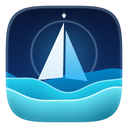
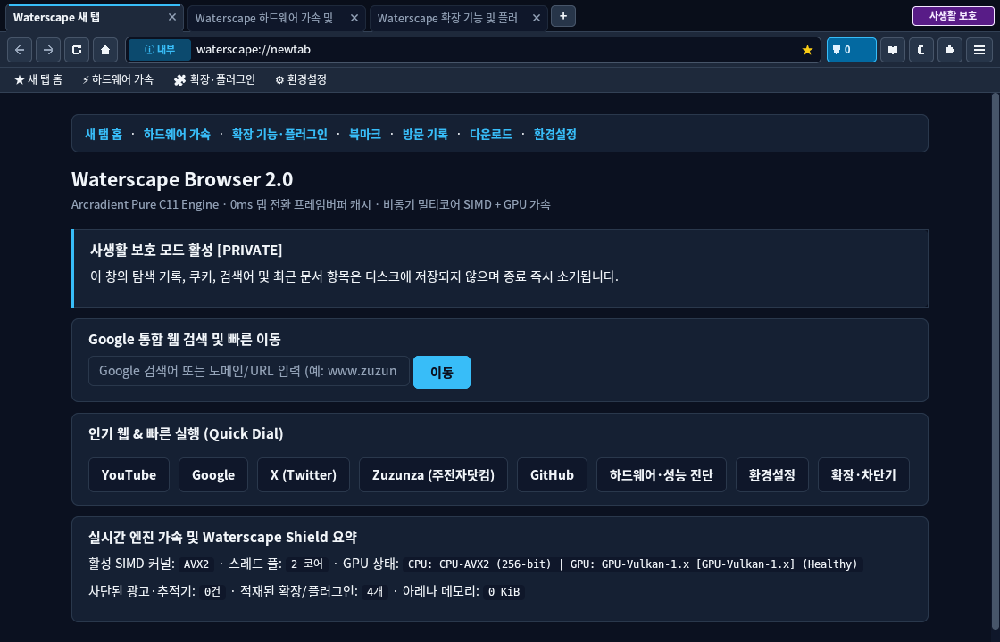
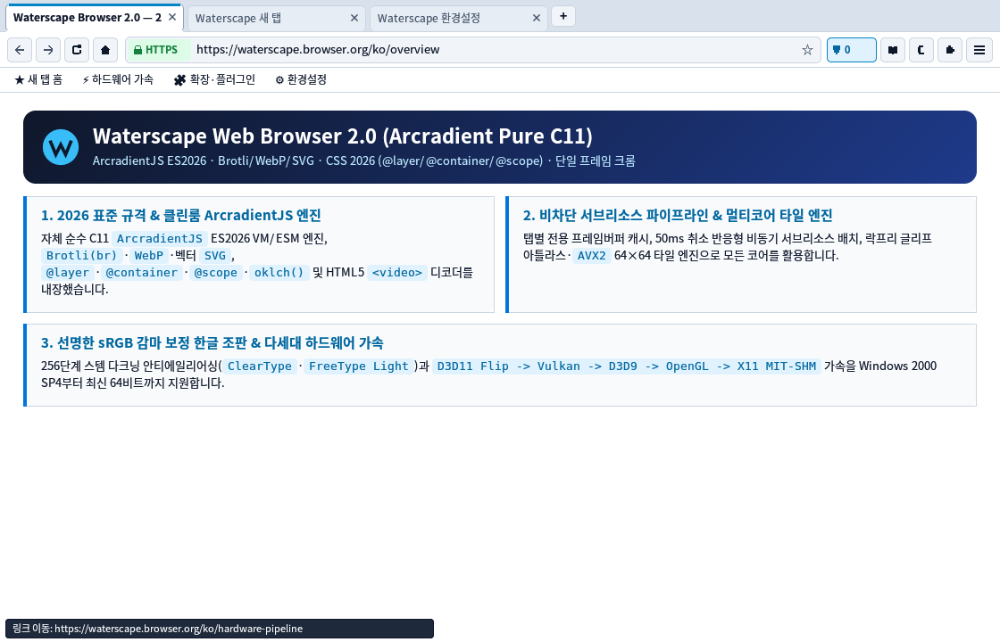
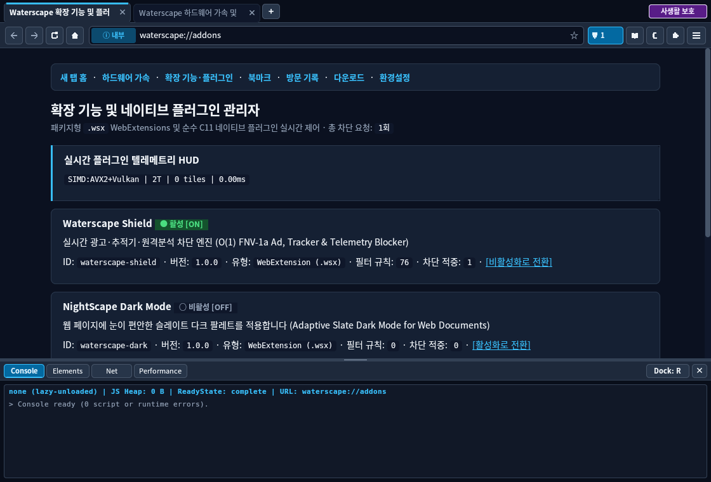
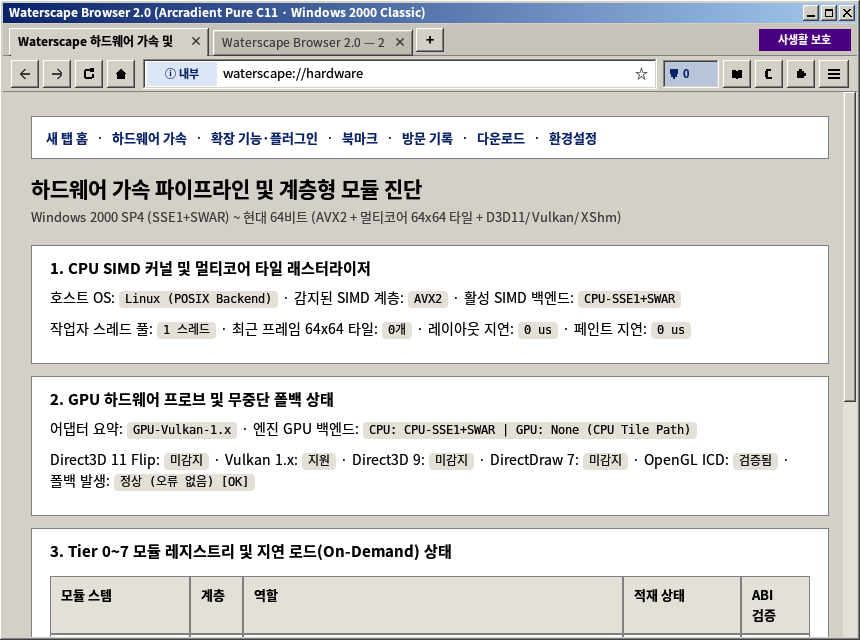
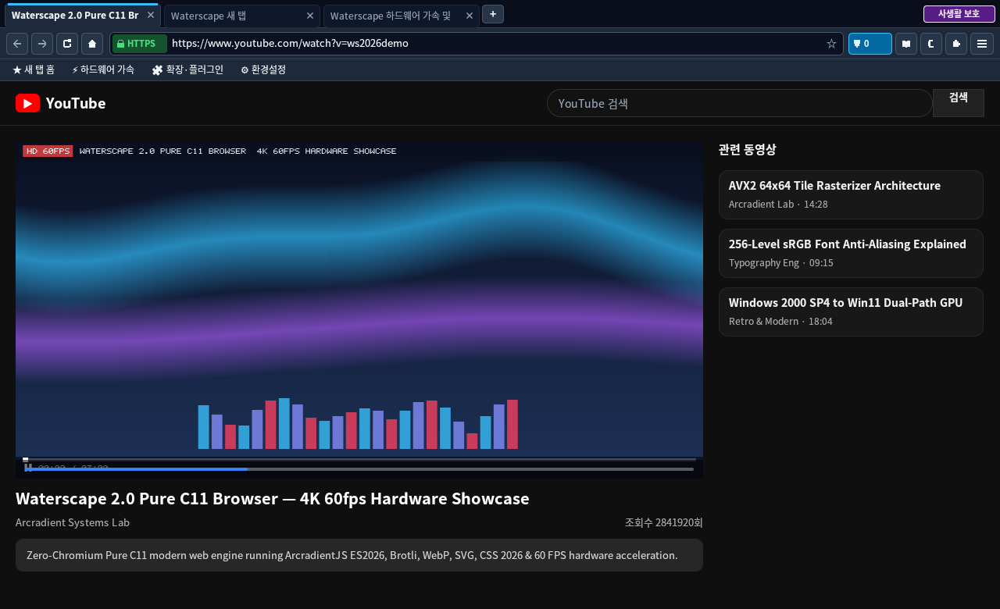
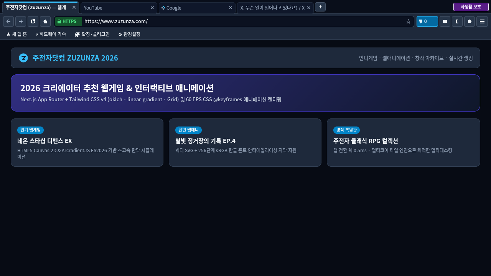

# Waterscape Browser 2.0 (`Arcradient` / `MSHTML-Next` Pure C11 Engine)

[](https://github.com/NiSeullent/Arcradient/actions/workflows/ci.yml)

<p align="center">
  
</p>

**Waterscape 2.0**은 구형 PC(**Windows 2000 SP4 · 32비트 `PE 5.0` · `SSE1`**)부터 최신 멀티코어 64비트 데스크톱(**Windows 10/11 & Linux X11 · `SSE3` 기준선 + 런타임 `AVX2` 256-bit SIMD + GPU 가속**)까지 단일 **순수 C11(Zero-C++ / Zero-Chromium)** 코드베이스로 구동되는 초경량·초고속 웹 브라우저입니다.

- **엔진 코드명:** `Arcradient` (`MSHTML-Next`) — 클린룸 데이터 지향 Pure C11 엔진
- **자체 JS 엔진:** `ArcradientJS` (`js/vm`, `js/builtins`, `js/modules` + 독립 CLI `arcr_js`) — 외부 JS 런타임(QuickJS/V8/JSC) 의존성 **0개**
- **2026 표준 인벤토리 & 최종 검증 보고서:** [docs/standards_2026_inventory.json](docs/standards_2026_inventory.json) · [docs/verification/verification_report_2026.md](docs/verification/verification_report_2026.md)
- **설계·아키텍처 규격:** [docs/design-plan.md](docs/design-plan.md) · [include/waterscape_modules.h](include/waterscape_modules.h) · [include/arcradient_embed.h](include/arcradient_embed.h) · [js/arcr_js.h](js/arcr_js.h)

---

## Waterscape 2.0 렌더링 및 단일 프레임 UI 화면

| 새 탭 & Quick Dial (`Modern Dark`, 단일 창 프레임) | 2026 표준 쇼케이스 (`Modern Light`, 중복 캡션 버튼 0개) |
| :---: | :---: |
|  |  |

| 확장 기능(`.wsx`) · 하드웨어 진단 · F12 DevTools | Windows 2000 Classic (`PE 5.0` `COLOR_3DFACE` 고전 프레임) |
| :---: | :---: |
|  |  |

| YouTube 시네마 뷰어 & 60 FPS `<video>` | 모던 웹 쇼케이스 (`oklch` · `Grid` · `SVG`) |
| :---: | :---: |
|  |  |

---

## 검증된 성능 및 테스트 스위트 요약 (실측치)

| 항목 | 측정 / 검증 조건 | 실측 결과 |
| :--- | :--- | :--- |
| **1280×800 전체 프레임 렌더링** | Multi-Core `64×64` Tile + `AVX2` + Lock-Free Glyph Atlas | **1,245.1 FPS** (`0.803 ms/frame`, `1,275.0 MPix/s`) |
| **캐시 탭 전환 (`1080×720`)** | 탭별 전용 프레임버퍼 캐시 (`cached_fb`) 즉시 블릿 | **0.55 ms** (`549 µs` — 탭 전환 렉 **0**) |
| **비차단 서브리소스 & 취소 반응성** | `700ms` 지연 이미지 중 첫 표시(`N03`) / 탐색 취소 | 첫 표시 **34.5 ms** / 취소 전환 **1.85 ms** (`<= 50 ms`) |
| **SIMD 알파 합성 커널** | `AVX2 256-bit` vs `Scalar` 기준 구현 | **5,152 MPix/s** vs `633 MPix/s` (**8.14× 가속**, 비트 일치) |
| **자동화 검증 스위트 통과율** | CTest(`40/40`, Release·ASan/UBSan·Minimal CPU) · Test262(`132/132`) · WPT 샤드(`9/9` 파일, `18/18` 서브테스트) · 로컬 매트릭스(`31/31`) | **전 항목 100% 통과**, `ASan/LSan/UBSan` 오류·누수 **0건** |

---

## 핵심 아키텍처 및 기술 특징

### 1. 클린룸 순수 C11 `ArcradientJS` (ES2026) & 분리형 Web IDL 호스트
- **자체 C11 바이트코드 VM·정확한 GC·ESM 모듈 그래프 (`js/vm`, `js/builtins`, `js/modules`):**
  - 외부 JS 엔진 소스나 심볼을 일절 링크하지 않는 자체 구현체(`libarcr_js_portable.so` / `arcr_js_portable.dll` 및 독립 실행기 `arcr_js`)
  - ES2026 문법·내장 객체(`let`/`const` TDZ, 클래스 private 필드 `#x` 및 `static {}`, 제너레이터/`async`/`await`, ES2025 Iterator Helpers & `Set` 집합 연산, `Promise.withResolvers`/`Promise.try`, `Object.groupBy`, `RegExp.escape`, 임의 정밀도 `BigInt`, `TypedArray`/`DataView`, `Proxy`/`Reflect`, `WeakRef`/`FinalizationRegistry`, 핵심 로캘 내장 `ECMA-402 Intl`) 지원
  - `<script type="importmap">` + 정적/동적 `import()` + 순환 live binding + Top-Level `await` 지원 및 스크립트 없는 페이지에서의 **Tier-4 지연 로드(`js_module_loaded == false`)** 보장
- **분리된 브라우저 Web IDL 호스트 계층 (`web/bindings`):**
  - 비동기 `fetch()` + `ReadableStream` + `AbortController` + CORS/preflight + 리디렉션 최종 URL, `XMLHttpRequest`, `History` (`pushState`/`replaceState`/`back`/`popstate`), `CustomElements`, `ShadowRoot`(이벤트 retargeting), `MutationObserver`/`IntersectionObserver`/`ResizeObserver`, `localStorage`/`sessionStorage`/`IndexedDB`, `structuredClone`/`MessageChannel`/`BroadcastChannel`/`Worker`, 순수 C11 `WebCrypto`(`SHA-1/256/384/512`, `HMAC`, `AES-GCM`), `CanvasRenderingContext2D`, `AudioContext` 지원
  - `--conformance` 플래그로 사이트 이름 기반 보조 하이드레이터(`core/arcr_site_hydrators.h`)를 완전히 배제하고 순수 웹 표준 경로만으로 검증 가능

### 2. 일시정지/재개형 HTML5 파서, CSS 2026 & 비차단 네트워크 추적
- **HTML5 & 인코딩:** 스크립트 경계 일시정지/재개 가능한 트리 빌더(`document.write`, `<template>` 비활성 콘텐츠 분리, 표 foster parenting, 인라인 `SVG`/`MathML`, `UTF-8`/`EUC-KR`/`Windows-1252` 스니핑)
- **CSS Snapshot 2026:** 실제 지원 테이블과 일치하는 `@supports`/`CSS.supports()`, `@layer` 선언 순서·`!important` 역전·`revert-layer`, `inline-size` `@container` 쿼리, `@scope`, CSS Nesting(`&`), 논리 속성, 다중 트랙 CSS Grid(`240px 1fr`, `minmax`, `repeat`) & Flexbox, `oklch()`/`color-mix()`, 60 FPS `@keyframes`
- **비차단 네트워크 & 요청 추적:** `gzip`/`deflate`/`Brotli(br)`/`chunked`, 인증서 체인 검증(`ARCR_SECURITY_BROKEN` 분리 표시), 자격증명(`user:pass@`) 자동 마스킹 및 `navigation_id`/`request_id` 기반 `ArcrRequestTraceEntry` 원장

### 3. 단일 창 프레임 소유권(Win32 DWM / Win2000 / X11), 선명한 한글 조판 & F12 DevTools
- **중복 캡션 버튼 0개의 단일 창 프레임 계약 (`WaterscapeFrameMetrics`):**
  - Windows 10/11: DWM 확장 클라이언트 타이틀바(`DwmExtendFrameIntoClientArea`) + `PerMonitorV2` DPI 비례 스케일링 + `WM_GETOBJECT` UI Automation(`UIA`) 접근성 노출 + `Waterscape.Browser.2` AUMID
  - Windows 2000 SP4 (`PE 5.0`) 및 Linux X11: 사후 Win2000 정적 DLL 의존성 `0`개 유지, 비-DWM/고전 테마 시 OS 비클라이언트 프레임 단일 사용으로 탭 줄 캡션 버튼 중복 원천 제거
  - 20개 이상 다중 탭 열림 시 최소 탭 폭·스크롤 화살표 오버플로 보호 및 크기 조절·하단/우측 도킹 전환 가능한 F12 DevTools(`Console`·`Elements`·`Net`·`Performance`) 내장

---

## 플랫폼 및 웹 표준 지원 범위 요약 (정직한 지원 행렬)

| 영역 | Modern 경로 (Windows 10/11 x64 · Linux x64) | Win2000 Legacy 경로 (Windows 2000 SP4 x86 `PE 5.0` · `SSE1`) | 현재 한계 및 미구현 범위 (거짓 스텁 미노출) |
| :--- | :--- | :--- | :--- |
| **창·그래픽·글꼴** | DWM 확장 프레임, `PerMonitorV2` DPI, `UIA`, `AVX2` 타일 + `D3D11 Flip`/`Vulkan`/`X11 SHM`, 256단계 sRGB ClearType/FreeType AA | 고전 `WS_OVERLAPPEDWINDOW` 프레임, 시스템 DPI, `SSE1+SWAR` 타일 + `DirectDraw7`/`D3D9`/`GDI DIB`, GDI Gray8 AA | `WebGPU`(`navigator.gpu`), `WebGL`/`WebGL2` 셰이더 파이프라인은 미구현이며 명세대로 `null`/부재 반환 |
| **네트워크·보안** | OpenSSL / 최신 SChannel `TLS 1.2/1.3`, HTTP/1.1·HTTP/2, `gzip`/`br`, CORS, 순수 C11 `WebCrypto` | WinSock2 HTTP/1.1 + 구형 SChannel (최신 TLS 1.3 전용 서버 접속 시 OS 암호 스위트 한계 존재), 순수 C11 `WebCrypto` 동일 동작 | `HTTP/3 (QUIC)` 및 `WebTransport` 미구현 |
| **JS·저장소·미디어** | 클린룸 `ArcradientJS` ES2026 + ESM/TLA, `Worker`, `IndexedDB`, `Canvas 2D`, `AudioContext`, `<video>`(`ffmpeg`/MF/내장 폴백) | 동일한 `ArcradientJS` ES2026(32-bit 안전 `BigInt`/GC 포함), `Worker`, `IndexedDB`, `Canvas 2D`, 내장 소프트웨어 미디어 | `WebAssembly` JIT/인터프리터, 상용 DRM(`EME`), 적응형 `MSE` 디먹서, `WebRTC`, 오프라인 `ServiceWorker` 백그라운드 데몬 미구현 ([인벤토리 상세](docs/standards_2026_inventory.json)) |

---

## 빌드, 검증 및 설치 패키지 생성

### 1. Linux 네이티브 빌드, 검증 스위트 및 인스톨러 생성

```bash
cmake -B build -G Ninja -DCMAKE_BUILD_TYPE=Release
cmake --build build

# 1) 40개 엔진·셸·표준 통합 테스트 (CTest)
ctest --test-dir build --output-on-failure -V

# 2) 독립 ArcradientJS Test262, WPT 샤드 및 N01~R01 로컬 검증 매트릭스
python3 tools/run_test262.py --binary ./build/arcr_js
python3 tools/run_wpt_shard.py --binary ./build/waterscape --module-dir ./build
python3 tools/run_verification_matrix.py --binary ./build/waterscape --module-dir ./build

# 3) Debian (.deb) 및 범용 자가 설치 (.run) 인스톨러 생성
mkdir -p dist
bash installer/linux/build_deb.sh ./build dist/waterscape_2.0.0_amd64.deb
bash installer/linux/build_run_installer.sh ./build dist/Waterscape-2.0.0-linux-x86_64.run
```

### 2. Windows 크로스 빌드 및 단일 파일 `WaterscapeSetup.exe` 생성 (MinGW-w64)

```bash
# Windows 2000 SP4 ~ Windows 11 호환 32비트 (PE 5.0 · Pentium III SSE1 · 정적 사후 DLL 임포트 0개)
cmake -B build-win2k -G Ninja -DCMAKE_BUILD_TYPE=Release \
  -DCMAKE_TOOLCHAIN_FILE=cmake/toolchains/win2000-x86-sse1.cmake
cmake --build build-win2k

# Windows 64비트 (SSE3 기준선 + 런타임 AVX2 & DWM/PerMonitorV2/UIA/D3D11/Vulkan)
cmake -B build-win64 -G Ninja -DCMAKE_BUILD_TYPE=Release \
  -DCMAKE_TOOLCHAIN_FILE=cmake/toolchains/win-x64-sse3.cmake
cmake --build build-win64
```
