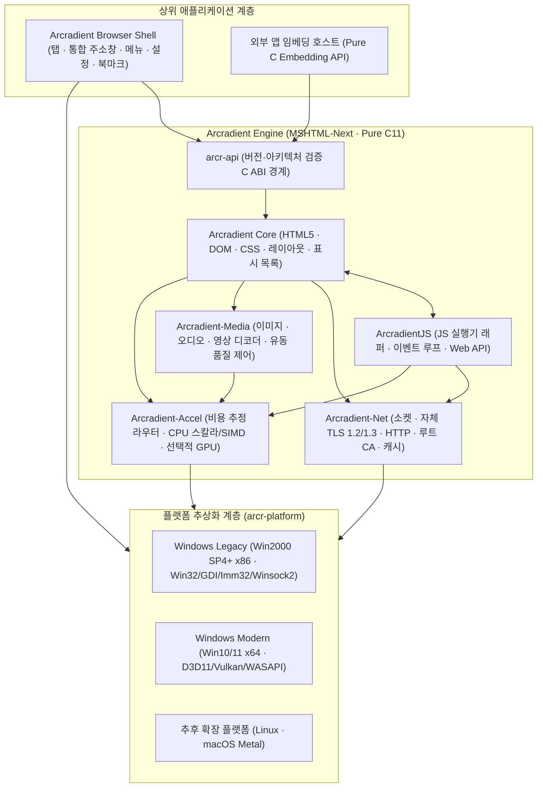
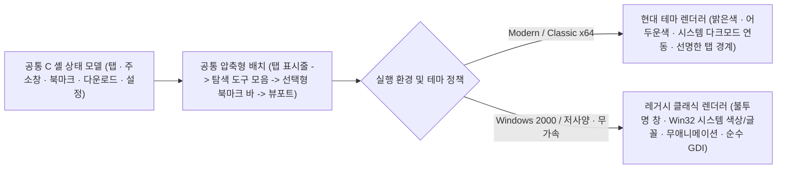
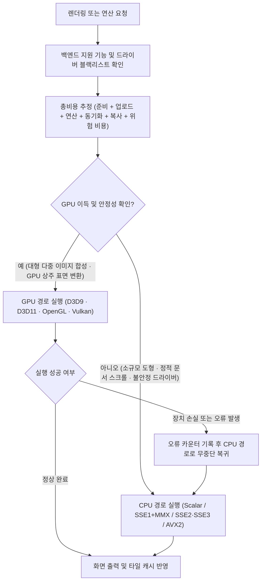
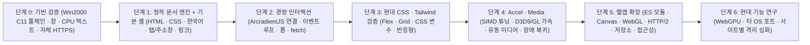

# Arcradient (MSHTML-Next) 통합 설계·개발 계획서

- **제품명:** Arcradient (`Arcradient Browser` / `Arcradient Engine`)
- **개발 코드명:** `MSHTML-Next`
- **핵심 구현 언어:** 순수 C (`C99` / `C11` 최소 부분집합, 무거운 외부 런타임 배제)
- **주요 하위 체계:** `Arcradient Browser Shell` (`arcr-shell`), `Arcradient Core`, `ArcradientJS` (`arcr-js`), `Arcradient-Accel` (`arcr-accel`), `Arcradient-Media` (`arcr-media`), `Arcradient-Net` (`arcr-net`)

`Arcradient`는 구형 PC에서 **CPU 소프트웨어 렌더링을 기본 경로**로 삼고, 검증된 가속 경로만 선택적으로 활용하는 경량 모듈형 웹 엔진 및 브라우저다. 목표는 단순히 코드 크기를 줄이는 데 그치지 않는다. **Windows 2000 SP4와 SSE1만 지원하는 32비트 PC부터 현대적인 64비트 시스템까지 단일 C 엔진 계열**로 묶고, 장비 여건에 맞춰 렌더링·미디어 품질을 유동적으로 조절하면서 현대 웹 호환성을 단계적으로 넓힌다.

브라우저 외형과 사용 경험은 **“처음 켜면 Chrome처럼 익숙하고, 만져 보면 Firefox처럼 조절할 수 있으며, Windows 2000에서도 제 모습으로 가볍게 돌아가는 브라우저”**를 지향한다.

> [!NOTE]
> 코드명 `MSHTML-Next`는 Trident급의 낮은 자원 사용량과 내장 친화적 모듈 구조를 계승한다는 설계 방향을 뜻한다. 기존 `mshtml.dll`, COM/ActiveX 인터페이스, 또는 구형 Internet Explorer 전용 비표준 동작과의 바이너리 호환성을 자동으로 의미하지 않는다.

---

## 1. 핵심 설계 원칙

### 1.1 CPU가 기본이고 GPU는 선택적 가속기
`Arcradient`는 다음 환경을 예외가 아닌 **정상 운용 환경**으로 간주한다.

- GPU가 아예 없거나 고정 파이프라인 초기 세대 수준으로 매우 오래됨.
- 그래픽 드라이버가 설치되어 있어도 불안정하거나 특정 API 호출이 느림.
- 시스템 메모리에서 VRAM으로 데이터를 올리고 다시 읽어 오는(Readback) 왕복 비용이 연산 이득보다 큼.
- 원격 데스크톱(RDP)이나 가상 머신(QEMU, VMware, VirtualBox 기본 VBE 드라이버 등)에서 하드웨어 가속이 제한됨.
- CPU가 오래되어 최신 SIMD 명령어 없이 스칼라 + 초기 SSE 명령어만 존재함.

따라서 모든 표준 렌더링 파이프라인과 브라우저 UI는 **CPU만으로 100% 화면을 완성**할 수 있어야 하며, GPU는 성능이나 전력 효율에서 측정 가능한 이득이 확인된 작업에만 투입한다.

### 1.2 기능은 필요할 때만 지연 로드 (On-Demand Module Loading)
정적 HTML 문서 하나를 열기 위해 거대한 브라우저 하위 체계를 한꺼번에 메모리에 적재하지 않는다.

- **초기 미적재 대상:** WebGPU 구현체, 오디오·영상 코덱, WebGL 셰이더 컴파일러, 개발자 도구, JavaScript VM 및 JIT 컴파일러, 고비용 그래픽 필터 처리기.
- **기본 적재 범위:** 브라우저 최소 셸 + HTML5 파서 + DOM + 기본 CSS + 한국어/유니코드 텍스트 배치 + CPU 래스터화 출력.
- 각 문서가 `<script>`, `<video>`, `canvas.getContext('webgl')`, 네트워크 요청 등을 실제로 수행하는 시점을 감지해 해당 C 동적 모듈(`.dll` / `.so` / `.dylib`)을 로드한다.

### 1.3 웹 표준 의미를 지키면서 시각·재생 품질을 조절
장치 성능에 따라 시각 품질이나 프레임 속도는 낮출 수 있지만, 웹 애플리케이션의 논리적 무결성을 깨뜨리는 임의 변형은 금지한다.

| 절대 보존 영역 (임의 변경 금지) | 적응형 조절 허용 영역 (환경별 유동 최적화) |
|---|---|
| JavaScript 연산 결과 및 부동소수점/타입 의미 | 스크롤·애니메이션 목표 프레임레이트 (예: 60fps → 30/20fps) |
| DOM 이벤트 전파 및 마이크로태스크 실행 순서 | 영상 재생 해상도 선택, 프레임 드롭, 색공간 변환 필터 단계 |
| CSS 선택자 매칭, 명시도(Specificity), 상속 규칙 | 그림자·블러(`backdrop-filter` 등)·보간 필터의 샘플링 품질 |
| `<form>` 직렬화 및 제출 데이터 값 | 비활성 탭 타이머 주기 및 오프스크린 타일/디코딩 이미지 캐시 크기 |
| TLS 인증서 체인·도메인 검증 및 동일 출처 정책(SOP) | GPU/SIMD 백엔드 경로 선택 및 메모리 압박 시 캐시 해제 수위 |

### 1.4 순수 C (C99/C11) 기반의 무의존성·고이식성 아키텍처
Windows 2000 SP4(x86)부터 현대 64비트 OS까지 단일 코드베이스를 유지하기 위해, 엔진 코어와 셸은 **순수 C (`C99`/`C11` 핵심 부분집합)**로 작성한다.

- **C++ 런타임 의존성 제거:** 현대 C++ 표준 라이브러리(`libc++`, `libstdc++`, 최신 `vcruntime`/`msvcp`)는 내부적으로 Windows Vista/7 이후 커널 심볼(`SRWLock`, `ConditionVariable`, `GetTickCount64`, 최신 로캘 API 등)을 호출해 Windows 2000 실행을 가로막기 쉽다. 순수 C 구조는 예외 처리(EH), RTTI, 이름 맹글링(Name Mangling) 오버헤드 없이 크기를 최소화한다.
- **명시적 메모리 수명 관리:** 전역 `malloc`/`free` 남발 대신 문서·프레임 수명에 맞춘 **Arena 할당자(Bump Allocator)**와 고정 크기 노드를 위한 **Slab Pool**을 기본으로 삼아 단편화와 할당 비용을 줄인다.
- **안정적인 C ABI 모듈 경계:** 모든 동적 모듈은 구조체 크기와 버전이 명시된 C 함수 포인터 테이블(`vtable`)만으로 통신한다.

---

## 2. 먼저 확정할 기술적 전제

### 2.1 Tailwind CSS는 WebGPU나 WebGL을 요구하지 않는다
Tailwind CSS는 빌드 시점에 표준 CSS 규칙을 생성하는 유틸리티 프레임워크다. 브라우저 입장에서 관건은 WebGPU 유무가 아니라 **생성된 CSS가 요구하는 현대 CSS 명세를 엔진이 얼마나 지원하는가**다.

- 특히 [Tailwind CSS 공식 호환성 문서](https://tailwindcss.com/docs/compatibility)가 명시하듯 Tailwind v4 결과물을 올바르게 그리기 위해서는 CSS 사용자 정의 속성(`var()`), `@layer` 캐스케이드 계층, 현대적 색상 함수(`oklch()`, `color-mix()`), `:is()`/`:where()`/`:has()` 선택자, Flexbox/Grid 핵심 배치가 중요하다.
- 따라서 책임을 다음과 같이 명확히 분리한다.
  - **Tailwind 기반 페이지 표시:** `arcr-core` · `arcr-css` · `arcr-layout` · `arcr-paint`의 책임.
  - **WebGL 사용 페이지:** `arcr-accel` 및 `arcr-webgl` 모듈의 책임.
  - **WebGPU 사용 페이지:** `arcr-accel` 및 별도 `arcr-webgpu` 모듈의 책임.

### 2.2 Bun은 파서가 아닌 런타임이며, 실행 환경별로 역할을 분리한다
[Bun 문서](https://bun.com/docs)에서 설명하듯 Bun은 내부적으로 WebKit의 **JavaScriptCore(JSC)**를 사용하는 통합 런타임이며, 공식 Windows 빌드는 [설치 요구사항](https://bun.com/docs/installation)상 **Windows 10 1809 이상 및 x64 SSE4.2**를 요구한다(`baseline` 빌드가 AVX만 제외할 뿐 SSE3 전용 구형 CPU나 32비트 Windows 2000을 뜻하지 않는다).

따라서 **“V8에 의존하지 않고 Bun/JSC 생태계를 활용한다”**는 방향을 지키면서 순수 C 엔진 구조에 맞춰 다음과 같이 나눈다.

1. **개발·빌드·검증 환경 (`tools/`):** Bun을 테스트 서버, WPT 실행기, 루트 인증서 번들 패커, 에셋 빌드 스크립트에 적극 사용한다(배포용 브라우저 실행 파일에는 Bun 의존성이 전혀 포함되지 않음).
2. **현대 64비트 시스템용 JS (`ArcradientJS-JSC`):** JavaScriptCore가 기본 제공하는 **순수 C API (`JavaScriptCore/JavaScript.h`: `JSContextGroupRef`, `JSObjectRef`)**를 통해 C++ 접착 계층 없이 임베딩을 우선 검토한다.
3. **레거시·초경량 시스템용 JS (`ArcradientJS-Portable`):** 순수 C99로 작성되어 Windows 2000 x86 SSE1 및 저메모리 조건을 만족하는 경량 ECMAScript 엔진(1순위 후보: `QuickJS-NG` / `QuickJS`, 비교 후보: `Duktape` / `MuJS`)을 검증해 연결한다.
4. **공통 래퍼 (`ArcradientJS`):** 상위 DOM과 Web API가 하위 실행기 종류에 구애받지 않도록 단일 C 인터페이스로 추상화한다.

---

## 3. 대상 플랫폼, C 툴체인 및 SIMD 기준

### 3.1 플랫폼 지원 매트릭스

| 구분 | 대상 운영체제 | 최소 CPU 조건 | 기본 렌더링 경로 | 선택적 하드웨어 가속 |
|---|---|---|---|---|
| **Legacy x86** | Windows 2000 SP4 이상 (32비트) | IA-32 + **SSE1** 이상 | CPU 스칼라 + SSE1/MMX 정수 | 검증된 Direct3D 9.0c / OpenGL ICD 드라이버 존재 시 |
| **Classic x64** | Windows XP Professional x64 / Server 2003 x64 이상 검토 | x86-64 + **SSE3** 이상 | CPU 스칼라 + SSE2/SSE3 | 지원 API 및 안정된 드라이버 존재 시 |
| **Modern x64** | Windows 10 / 11 이상 (64비트) | x86-64 + **SSE3** 기본 유지 | CPU 스칼라 + SSE2/SSE3 (+ 런타임 AVX2) | Direct3D 11 · Vulkan · OpenGL 등 |
| **기타 플랫폼** | Linux · macOS 등 (코어 안정화 후) | 아키텍처별 별도 기준 | CPU 소프트웨어 렌더링 | Linux(Vulkan/GL), macOS(Metal) |

> [!IMPORTANT]
> 구현 1순위는 **Windows x86(Legacy) 및 Windows x64(Modern)**다. Linux는 개발·자동화 검증용 헤드리스/기본 창 백엔드로 병행 활용하되, 사용자 배포용 Linux·macOS 정식 포트와 Metal 백엔드는 Windows 공통 코어가 안정화된 뒤 확장한다.

### 3.2 순수 C 빌드 체인 및 Windows 2000 SP4 바이너리 규격
현대 컴파일러로 빌드한 실행 파일이 Windows 2000 SP4에서 `"올바른 Win32 응용 프로그램이 아닙니다"` 오류나 심볼 누락으로 실패하지 않도록 다음 빌드 규칙을 강제한다.

- **표준 수준:** `-std=c11` (단, 선택 사양인 `<threads.h>`, `<stdatomic.h>` 직접 의존과 가변 길이 배열 `-Wvla`는 금지하고 `arcr_thread.h`, `arcr_atomic.h` 추상화 헤더 사용).
- **PE 헤더 하위 시스템 버전 고정:** 링커 옵션을 통해 OS 및 Subsystem 버전을 `5.0`(`--major-subsystem-version 5 --minor-subsystem-version 0`, `_WIN32_WINNT=0x0500`, `WINVER=0x0500`)으로 명시한다.
- **CRT 및 커널 심볼 정책:**
  - 외부 재배포 패키지(`vc_redist`) 설치 없이 즉시 실행되도록 시스템 기본 `kernel32.dll`, `user32.dll`, `gdi32.dll`, `imm32.dll`, `ws2_32.dll`, `advapi32.dll`, `msvcrt.dll`만 기본 참조한다.
  - Windows 2000 내장 `msvcrt.dll`(VC6 계열)은 C99 `snprintf` 널 종료 보장과 `%zu`·`%lld` 형식 지정자가 불완전하므로, `arcr-base` 내부에 자체 경량 `arcr_snprintf`·UTF-8 변환·메모리 풀 루틴을 내장한다.
  - Windows XP 이후 추가된 API(`BCryptGenRandom`, `GetTickCount64`, `AddVectoredExceptionHandler`, `Direct3DCreate9Ex` 등)는 정적 임포트 테이블에 넣지 않고 반드시 런타임 `GetProcAddress`로 조회한다.

### 3.3 SSE 명령어 세부 운용 조건
- **32비트 Legacy x86 (`SSE1` 전용 CPU의 현실적 한계 반영):**
  - Pentium III·초기 Athlon XP 급의 `SSE1`은 128비트 `float` 4개 병렬 연산(`__m128`)과 64비트 MMX 확장 정수 명령(`PSHUFW`, `PMULHUW`, `PAVGB`)만 제공하며, 128비트 정수 레지스터 연산(`SSE2`)과 64비트 `double` SIMD가 없다.
  - 따라서 행렬 변환·선형 보간·부동소수점 색상 연산에는 `SSE1`을 쓰고, `ARGB8888` 픽셀 알파 블렌딩은 **고정소수점 64비트 스칼라(SWAR: 32/64비트 레지스터 내 채널 분리 기법) 또는 MMX 확장 루틴(종료 시 `_mm_empty()` 필수)**과 조합한다.
- **64비트 Classic / Modern x64 (`SSE3` 기본선):**
  - x86-64는 `SSE2` 128비트 정수/실수 벡터를 기본 내장하므로 한 번에 4픽셀(`16바이트`) 합성·블러·색공간 변환을 처리한다. 최소 빌드 기준은 `SSE3`(`-msse3`, `SSE4.x`/`AVX` 미포함)로 고정한다.
- **런타임 디스패치:** 시작 시 `CPUID`와 OS 컨텍스트 저장 지원 여부(`XGETBV`)를 확인해, 가능할 때만 `arcr-accel`의 함수 포인터 테이블을 `SSE4.2` / `AVX2` 최적화 구현으로 교체한다.

---

## 4. 전체 아키텍처 및 모듈 구성

### 4.1 엔진과 브라우저 셸의 분리 구조
브라우저 UI 때문에 웹 렌더러 전체가 무거워지거나 외부 프로그램 내장이 어려워지는 일을 막기 위해, **`Arcradient Engine`과 `Arcradient Browser Shell`을 엄격히 분리**한다.



### 4.2 모듈 구성 및 적재 정책

| 모듈 이름 | 산출물 예시 (Windows) | 핵심 역할 | 기본 로드 여부 |
|---|---|---|---|
| `arcr-base` | `arcr_core.dll` 내장 | Arena/Slab 할당자, UTF-8/원자 문자열(`ArcrAtom`), C99 CRT 보완, CPUID | 예 |
| `arcr-core` | `arcr_core.dll` | HTML5 파서, DOM 트리, 문서 생명주기, 임베딩 C API | 예 |
| `arcr-css` | `arcr_core.dll` (통합 가능) | CSS 파싱, 선택자 인덱싱, 캐스케이드, 계산된 스타일 공유 | 예 |
| `arcr-layout` | `arcr_core.dll` (통합 가능) | 블록/인라인/Flex/Grid 배치, 한국어·다국어 줄바꿈 | 예 |
| `arcr-paint` | `arcr_core.dll` (통합 가능) | 표시 목록(Display List), 더티 영역 추적, 타일 합성, CPU 기준 래스터화 | 예 |
| `arcr-accel` | `arcr_accel.dll` (+ 백엔드별 DLL) | 비용 추정기, SIMD 디스패치, GPU 백엔드 지연 적재 및 장애 복귀 | 라우터만 기본 로드 (GPU 백엔드는 지연 로드) |
| `arcr-net` | `arcr_net.dll` | DNS, 자체 TLS 1.2/1.3, 루트 인증서 검증, HTTP, 쿠키·디스크 캐시 | 네트워크 요청 시 (로컬 파일 열람 시 생략 가능) |
| `arcr-image` | `arcr_image.dll` | PNG, JPEG, GIF, BMP, WebP, AVIF 지연 디코딩 | 이미지 요소 감지 시 |
| `arcr-js` | `arcr_js_portable.dll` / `arcr_js_jsc.dll` | ECMAScript 실행기 연결, 마이크로태스크/이벤트 루프, Web API 바인딩 | 페이지 내 스크립트 실행 필요 시 |
| `arcr-media` | `arcr_media.dll` | MP4/WebM 역다중화, 오디오·영상 디코딩, A/V 동기화, 유동 화질 제어 | `<audio>` / `<video>` 재생 요청 시 |
| `arcr-webgl` | `arcr_webgl.dll` | WebGL 컨텍스트, 셰이더 검증·변환, 버퍼/텍스처 상태 관리 | `getContext('webgl')` 요청 시 |
| `arcr-webgpu` | `arcr_webgpu.dll` | WebGPU 보안 검증, 파이프라인/컴퓨트 변환 | `navigator.gpu` 요청 시 (현대 환경 우선) |
| `arcr-devtools` | `arcr_devtools.dll` | DOM/스타일 검사기, 네트워크·메모리 프로파일러, 콘솔 확장 | 사용자 호출 시 (`F12` 등) |
| `arcr-shell` | `arcradient.exe` | 네이티브 브라우저 창, 탭·주소창·메뉴·북마크·다운로드·설정 UI | 브라우저 단독 실행 시 |

> [!TIP]
> `Legacy Minimum` 배포판에서는 DLL 테이블 오버헤드와 주소 공간 재배치(Rebase) 비용을 줄이기 위해 `arcr-base`·`core`·`css`·`layout`·`paint`를 단일 `arcr_engine.dll`(약 수백 KB~수 MB 목표)로 묶고, 선택 모듈(`js`, `media`, `accel_d3d9`, `devtools` 등)만 별도 DLL로 분리한다.

### 4.3 버전 명시 순수 C 모듈 ABI 규격
레거시 빌드 DLL과 현대 빌드 DLL이 섞여 로드되거나 CPU 미지원 명령어로 크래시가 나는 사고를 원천 차단하기 위해, 모든 동적 모듈은 `arcr_module_query()` 심볼 하나만 먼저 노출해 아래 디스크립터를 검증받는다.

```c
#include <stdint.h>

#define ARCR_MODULE_MAGIC 0x52435241u /* "ARCR" */
#define ARCR_ABI_VERSION  0x00010000u /* v1.0 */

typedef enum ArcrArchId {
    ARCR_ARCH_X86_32 = 1,
    ARCR_ARCH_X86_64 = 2,
    ARCR_ARCH_ARM64  = 3
} ArcrArchId;

typedef enum ArcrCpuFlags {
    ARCR_CPU_SCALAR = 0,
    ARCR_CPU_SSE1   = 1u << 0,
    ARCR_CPU_SSE2   = 1u << 1,
    ARCR_CPU_SSE3   = 1u << 2,
    ARCR_CPU_SSE4_2 = 1u << 3,
    ARCR_CPU_AVX2   = 1u << 4
} ArcrCpuFlags;

typedef struct ArcrModuleDescriptor {
    uint32_t    magic;              /* ARCR_MODULE_MAGIC */
    uint32_t    struct_size;        /* sizeof(ArcrModuleDescriptor) */
    uint32_t    abi_version;        /* 엔진 코어 ABI 버전과 일치 필수 */
    uint32_t    engine_build_id;    /* 릴리스/빌드 호환 식별자 */
    uint16_t    arch_id;            /* ArcrArchId */
    uint16_t    min_os_major_minor; /* 예: Win2000 = 0x0500, Win10 = 0x0A00 */
    uint32_t    required_cpu_flags; /* 로드 전 현재 CPUID 지원 비트와 AND 비교 */
    const char *module_name;        /* 예: "arcr-js-portable" */
    const void *vtable;             /* 모듈별 버전 명시 함수 포인터 구조체 */
} ArcrModuleDescriptor;
```

엔진 로더는 `magic`, `struct_size`, `abi_version`, `arch_id`, 현재 OS 버전, 그리고 `(host_cpu_flags & desc->required_cpu_flags) == desc->required_cpu_flags`를 모두 통과한 경우에만 모듈 초기화를 호출한다.

---

## 5. 브라우저 셸 (`Arcradient Browser Shell`) 설계

### 5.1 UX 방향성: Chrome의 간결함과 Firefox의 사용자 제어성 결합
첫 실행 화면에서는 탭과 통합 주소창만으로 즉시 웹 탐색을 시작할 수 있고, 세부 기능이 필요한 사용자는 메뉴와 설정에서 자유롭게 도구를 꺼내 쓸 수 있도록 구성한다.

| 설계 영역 | `Arcradient Browser`의 선택 |
|---|---|
| **기본 인상** | Chrome처럼 군더더기 없이 웹 콘텐츠 영역이 중심이 되는 간결한 화면 |
| **탭 표시줄** | Firefox처럼 활성 탭의 색상 대비와 경계선을 명확히 구분하고, 비활성 탭은 시각적 무게를 낮춤 |
| **통합 주소창** | URL 입력과 검색어 입력을 하나로 통합하되, 검색 엔진을 사용자가 손쉽게 전환·추가 가능 |
| **단일 메뉴** | 우측 메뉴 버튼은 하나로 유지하며 다운로드·방문 기록·북마크·확장 기능·설정에 일관되게 접근 |
| **설정 이원화** | 일반 사용자를 위한 간결한 기본 설정 화면(`arcr://settings`)과 고급 제어용 세부 설정(`arcr://config`) 분리 |
| **도구 모음 사용자 지정** | 북마크 바 표시 여부, 홈 버튼 노출, 도구 모음 아이콘 배치를 사용자가 선택 가능 |
| **테마 체계** | 밝은색(Light) · 어두운색(Dark) · 시스템 설정 따르기 + 레거시 OS 네이티브 클래식 테마 |

### 5.2 기본 화면 수직 배치 (압축형 높이 기본)
800×600, 1024×768 같은 저해상도 구형 모니터에서도 웹 문서 가시 영역이 답답하지 않도록 **과도한 여백을 배제한 압축형(Compact) 도구 모음 높이**를 기본값으로 채택한다. 탭과 주소창 모서리는 부드럽게 둥글리되 두꺼운 장식 테두리는 쓰지 않는다.

```text
+----------------------------------------------------------------------------------+
| [ 활성 탭: 한국어 문서 예제  x ]  [ 다른 탭  x ]  [+]                 [_] [ㅁ] [X] |  1. 탭 표시줄 ( ~28-30px )
+----------------------------------------------------------------------------------+
| [<] [>] [↻] | [자물쇠] https://example.org/docs                  [★] |   [≡]    |  2. 탐색 도구 모음 ( ~30-32px )
+----------------------------------------------------------------------------------+
| (선택형 북마크 바: 기본 숨김, 설정 또는 단축키 Ctrl+Shift+B로 즉시 토글)           |  3. 선택형 북마크 바 ( ~24px )
+----------------------------------------------------------------------------------+
|                                                                                  |
|                                                                                  |
|                             웹 콘텐츠 렌더링 영역                                 |  4. 웹 콘텐츠 영역 (최대 확보)
|                         (Arcradient Engine Viewport)                             |
|                                                                                  |
|                                                                                  |
| +---------------------------------------+                                        |
| | https://example.org/next-page         |                                        |  5. 상태 오버레이 (임시 표시)
+-----------------------------------------+----------------------------------------+
```

1. **탭 표시줄:** 새 탭(`+`), 탭 닫기(`x`), 마우스 드래그 및 키보드 탭 순서 변경, 탭 오디오 재생/음소거 표시.
2. **탐색 도구 모음:** 뒤로·앞으로·새로고침(로딩 중 정지 전환), 통합 주소·검색창(좌측에 TLS 보안/사이트 권한 배지, 우측에 북마크 별표 버튼 내장), 우측 단일 메뉴 버튼(`≡`).
3. **선택형 북마크 바:** 첫 실행 시 숨겨 세로 공간을 확보하고, 설정에서 켰을 때만 나타난다.
4. **웹 콘텐츠 영역:** 나머지 클라이언트 영역 전체를 엔진 뷰포트에 할당한다.
5. **임시 상태 표시(Status Overlay):** 고정 상태 표시줄로 공간을 낭비하지 않고, 링크 위에 마우스를 올리거나 네트워크 연결·로딩 진행 중일 때만 좌측 하단에 작은 불투명 배지로 잠깐 표시한다.

### 5.3 환경 적응형 UI 렌더링 (현대 OS vs Windows 2000 레거시)
**기능 배치와 단축키 체계는 모든 플랫폼에서 동일하게 유지**하되, 실제 창 테두리와 위젯을 그리는 경로만 운영체제 환경에 맞춰 전환한다.



Windows 2000 등 구형 환경에서 현대 브라우저 외형을 억지로 흉내 내느라 알파 합성·커스텀 그림자 때문에 UI 자체가 느려지는 일을 철저히 피한다.

- **불투명 창 기본:** 반투명 유리 효과(`WS_EX_LAYERED` 전체 창 알파 블렌딩)나 배경 흐림 효과를 쓰지 않고 직사각형 불투명 클라이언트 영역을 사용한다.
- **OS 네이티브 글꼴·색상 반영:** `GetSysColor()`와 `SystemParametersInfoW(SPI_GETNONCLIENTMETRICS)` 설정을 읽어 Windows 2000 고전 테마, 사용자 지정 배색, 시스템 기본 한글 글꼴(굴림 등)과 자연스럽게 어우러지게 한다.
- **저해상도 픽셀 정렬 아이콘:** 96 DPI 저해상도 모니터에서 뭉개지지 않도록 16×16 정수 픽셀 그리드에 맞춘 선명한 비트맵/단순 벡터 아이콘을 제공한다.
- **UI 애니메이션 비활성화:** 탭 열기·닫기 슬라이드나 페이드 애니메이션을 기본적으로 생략해 클릭 즉시 반응하게 한다.
- **무가속 GDI 보장 및 접근성:** GPU가 전혀 없어도 탭·주소창·팝업 메뉴가 Win32 기본 컨트롤과 더블 버퍼링 GDI만으로 깜빡임 없이 그려지며, 고대비 모드(`SPI_GETHIGHCONTRAST`)와 전체 키보드 탐색(`Ctrl+L`/`Alt+D`, `Ctrl+T`, `Ctrl+W`, `Ctrl+Tab`, `F6` 영역 순환, `Alt` 메뉴 니모닉)을 지원한다.

### 5.4 셸 내장 데이터 및 엔진 연결 C API
- **경량 로컬 저장소:** 북마크·방문 기록·다운로드 목록·설정은 무거운 외부 DB 없이도 동작하도록 컴팩트 바이너리 저널 포맷(또는 선택적 경량 `SQLite` 단일 C 아말가메이션 빌드)으로 저장한다.
- **임베딩 C API (`include/arcradient_embed.h`):** 브라우저 셸은 엔진 내부 자료구조를 직접 건드리지 않고, 외부 앱 개발자와 동일한 공개 C 핸들(`ArcrEngine*`, `ArcrWebView*`)과 콜백(`on_paint_dirty_rect`, `on_title_changed`, `on_url_changed`, `on_security_state`, `on_hover_link`, `on_download_request`)만 사용한다.

---

## 6. `ArcradientJS` 설계

### 6.1 역할 및 처리 파이프라인
`ArcradientJS`는 단순 구문 파서가 아니라 브라우저의 동적 실행 계층 전체를 담당한다.

```text
JS 소스(UTF-8) -> 어휘/구문 분석 -> 바이트코드 생성(선택 캐시) -> 인터프리터 / 선택적 JIT
               -> C 바인딩 계층 -> DOM / CSSOM / Fetch / Canvas 호출 -> 마이크로태스크 및 이벤트 루프
```

- **단계별 포함 범위:**
  - ECMAScript 표준 구문 파싱 및 실행, 모듈 스크립트(`import`/`export`).
  - 핵심 DOM 탐색·조작(`querySelector`, `Element`, `Node`, `ClassList`), 이벤트 리스너(`addEventListener`, 버블링·캡처링).
  - 타이머(`setTimeout`, `setInterval`, `requestAnimationFrame`), `Promise` 및 마이크로태스크 큐.
  - `fetch` / `Headers` / `Request` / `Response` 네트워크 연동, `URL` / `URLSearchParams`.
  - 2D `Canvas` API, 콘솔 및 구조화된 오류 보고.
- 처음부터 수천 개의 Web API 전체를 약속하지 않는다. 실제 목표 웹사이트가 요구하는 API부터 우선순위에 따라 구현하며, 미구현 API는 호환성 매트릭스에 투명하게 기록하고 기능 감지(`typeof window.SomeAPI === 'undefined'`)가 정직하게 동작하도록 한다.

### 6.2 순수 C 친화적 실행기 3원화 전략

| 실행기 모듈 | 대상 환경 | 순수 C 기반 구현 및 후보 전략 |
|---|---|---|
| **`ArcradientJS-Portable`** | Windows 2000 SP4, x86 SSE1, 저메모리 PC | 순수 C99 인터프리터 중심. **1순위 검증 후보: `QuickJS-NG` / `QuickJS`** (순수 C, 수백 KB 크기, ES2023+ 문법 지원, 참조 카운팅+순환 수집으로 유휴 메모리 최소화). 극단적 저사양 보조 후보로 `Duktape`/`MuJS` 병행 비교 후 확정. |
| **`ArcradientJS-JSC`** | SSE4.2 이상을 지원하는 현대 64비트 시스템 | WebKit **JavaScriptCore의 공식 순수 C API(`JavaScript.h`)** 임베딩 우선 검토. 다단계 인터프리터·JIT 성능 활용. |
| **`ArcradientJS-Legacy-JIT`** | 추후 선택 과제 | `Portable` 실행기 위에서 루프·핫 함수에 한해 x86 SSE1/정수 명령어만 생성하는 초경량 베이스라인 JIT 연구. |

> [!WARNING]
> 현대 JavaScriptCore 전체를 32비트 Windows 2000에 무리하게 백포트하거나, 프로젝트 초기에 ECMAScript 엔진을 바닥부터 독자 구현하는 일에 매달리지 않는다. 렌더러와 현대 JS VM을 동시에 새로 작성하면 일정과 유지보수 복잡도가 폭증하므로, 검증된 순수 C 엔진(`QuickJS` 계열 등)의 Windows 2000 x86 SSE1 빌드·통과율·라이선스(MIT 등)를 단계 0에서 실측해 채택한다.

### 6.3 JS 자원 절감 및 보안 경계
- **무스크립트 페이지 제로 비용:** 문서에 실행 가능한 `<script>`나 인라인 이벤트 핸들러가 없으면 `arcr-js` 모듈과 VM 힙 자체를 생성하지 않는다.
- **버전 일치형 바이트코드 캐시:** 엔진 버전, 아키텍처 엔디안, 실행기 설정 해시가 정확히 일치할 때만 컴파일된 바이트코드를 디스크 캐시에 재사용한다.
- **배경 탭 및 DOM 배칭 최적화:** 비활성 탭은 타이머 깨우기 빈도를 늦추고(`1Hz` 등), 동일 태스크 틱 내 연속적인 DOM 스타일 변경은 더티 비트만 표시한 뒤 프레임 직전에 한 번만 레이아웃을 재계산한다.
- **메모리 압박 단계별 회수:** 시스템 가용 메모리가 임계치 아래로 내려가면 JIT 코드 버퍼 → 바이트코드 캐시 → 비활성 컨텍스트 강제 GC 순으로 즉시 반환한다.
- **엄격한 권한 격리 및 CPU 실행 원칙:** 개발 도구용 Bun이 가진 로컬 파일·프로세스·소켓 권한은 브라우저 JS 환경에 절대 노출하지 않는다. 또한 동적 타입과 부작용이 많은 일반 JS 코드는 임의로 GPU에 분산하지 않으며, 오직 `Canvas`·`WebGL`·`WebGPU` 등 명시적 그래픽 요청만 `Arcradient-Accel`로 전달한다.

---

## 7. HTML · DOM · CSS 엔진 및 한국어 처리

### 7.1 HTML5 파싱과 저오버헤드 C DOM
- **실전 오류 복구:** 실제 웹 문서는 태그 중첩 오류나 생략이 흔하므로 단순 XML 파서가 아닌 **WHATWG HTML5 토크나이저·트리 구성 상태 기계**의 핵심 오류 복구 규칙을 순수 C로 구현한다.
- **컴팩트 DOM 메모리 배치:**
  - 모든 태그명(`div`, `span`), 속성명(`class`, `id`), 자주 쓰이는 CSS 키워드는 **전역/문서 원자 문자열 테이블(`ArcrAtom`, 32비트 정수 ID)**로 인터닝(Interning)하여 문자열 중복 저장과 `strcmp` 비용을 없앤다.
  - DOM 노드는 문서 전용 `ArcrArena` 및 크기별 Slab에서 연속 할당하여 포인터 추적 시 CPU L1/L2 캐시 적중률을 높이고, 탭을 닫을 때 개별 노드 수만 개를 순회 해제하는 대신 Arena 블록 통째로 즉시 반환한다.

### 7.2 CSS 렌더링 파이프라인과 최적화

```text
CSS 토크나이저/파서 -> 선택자 인덱싱(ID·Class·Tag·속성) -> 조상 블룸 필터 후보 축소
                    -> 스타일 공유 캐시 조회/계산 -> 부분 무효화 -> 부분 레이아웃
                    -> 표시 목록(Display List) 부분 갱신 -> 더티 영역·타일 합성 출력
```

- **선택자 인덱싱 및 블룸 필터(Bloom Filter):** 규칙을 우측 핵심 선택자(Key Selector)의 ID·클래스·태그 해시 버킷으로 분류하고, 트리 순회 중 64비트 조상 블룸 필터로 불일치 후손 선택자를 `O(1)`에 조기 탈락시킨다.
- **계산된 스타일 공유(Style Sharing):** 동일 부모 스타일, 동일 태그·클래스 집합, 인라인 스타일 부재 등 조건이 같은 형제 요소끼리 `ArcrComputedStyle` 구조체를 참조 공유(Copy-on-Write)한다.
- **엄격한 무효화 조건 검증:** 상속 속성 변경, 상대 단위(`em`, `rem`, `%`, `vw`, `vh`), 웹폰트 교체, 뷰포트/컨테이너 크기 변경 시 잘못된 캐시가 남지 않도록 의존성 비트마스크(`ARCR_DEP_VIEWPORT`, `ARCR_DEP_FONT_METRICS`, `ARCR_DEP_PARENT_SIZE` 등)를 기록해 불확실할 때는 정확히 재계산한다.
- **타일 캐시 및 더티 사각형(Dirty Rect):** 스크롤 시 문서 전체를 다시 래스터화하지 않고 뷰포트 주변 고정 크기 타일(예: `256×256`)만 유지하며, 일부 요소만 바뀐 경우 교차하는 더티 영역만 다시 그려 합성한다.

### 7.3 CSS 단계별 구현 우선순위 및 Tailwind 검증 원칙

| 단계 | 구현 범위 | 비고 |
|---|---|---|
| **1단계** | 박스 모델(`margin`/`border`/`padding`), 블록·인라인 흐름, 기본 색상·배경, 글꼴, 기본 선택자 | 정적 문서 열람 기반 |
| **2단계** | `display`, `position`(`relative`/`absolute`/`fixed`/`sticky`), 미디어 쿼리(`@media`), CSS 변수(`var()`) | 반응형 레이아웃 기초 |
| **3단계** | Flexbox 전체 핵심, CSS Grid 핵심 배치, 2D `transform`, `box-sizing`, `@layer` | 실용 웹 UI 및 Tailwind 핵심 |
| **4단계** | 상태·구조 선택자(`:hover`, `:focus-visible`, `:is`, `:where`), 트랜지션·애니메이션, 필터, 고급 텍스트 | 대화형 웹앱 완성도 향상 |
| **5단계** | 현대 색상 공간(`oklch`, `color-mix`), `:has()`, 컨테이너 쿼리 등 목표 사이트 필수 기능 | 측정 및 수요 기반 확장 |

Tailwind CSS는 별도 전용 처리기를 두지 않고, **사전 정의된 Tailwind 실제 테스트 페이지 모음**을 통해 `flex`, `grid`, 반응형 접두사(`sm:`, `md:`), 상태 접두사(`hover:`, `dark:`), `var()` 등이 표준 CSS 엔진 위에서 정확히 작동하는지 검증한다. 검증되지 않은 버전 전체의 완전 호환을 성급히 주장하지 않고 실제 지원 속성 표를 공개한다.

### 7.4 글꼴 렌더링과 한국어 초기 내장 (1등급 요구사항)
초기에 라틴 문자(ASCII) 전용으로 텍스트 엔진을 설계하면 추후 한국어를 붙일 때 줄바꿈·입력·폰트 체계를 전면 재작성해야 하므로, **단계 0~1부터 한국어를 핵심 요구사항으로 포함**한다.

- **문자 인코딩:** 엔진 내부 표준은 `UTF-8`로 통일하되, 레거시 한국어 웹 문서를 위해 `EUC-KR` / `CP949` 디코더를 `arcr-base`에 기본 내장하고, Win32 API 호출 경계에서만 `UTF-16LE`(`W` 접미사 유니코드 API — Windows 2000은 NT 커널이므로 기본 지원)로 변환한다.
- **한국어 조판 및 줄바꿈 규칙:**
  - 유니코드 정규화(NFC/NFD 한글 자모 결합 처리) 및 어절(공백)·음절 단위 줄바꿈(`word-break: normal` vs `keep-all` vs `break-all`) 정확 구현.
  - 한글·영문·숫자 혼용 시 베이스라인 정렬과 자간 조화, CJK 행두·행말 금칙처리(마침표·쉼표·닫는 괄호가 줄 첫머리에 오지 않도록 처리).
- **폰트 폴백 체인:** 문서 지정 글꼴에 한글 글리프가 없을 때 환경별 기본 한글 글꼴(Windows 2000/XP: `굴림`/`돋움`/`바탕`, 최신 Windows: `맑은 고딕`, 기타 OS: `Noto Sans CJK` 등)로 즉시 글리프 단위 폴백한다.
- **저해상도 가독성 vs 고해상도 스케일링:** Windows 2000 시절 구형 한글 글꼴이 저해상도(12~16px)에 내장한 비트맵 스트라이크(`EBDT`/`EBLC`)와 GDI 클리어타입/그레이스케일 힌팅을 존중해 작은 글씨 가독성을 확보하고, 현대 HiDPI 모니터에서는 Per-Monitor DPI 스케일링을 지원한다.
- **한국어 IME 조합 완벽 지원:** Windows `imm32.dll`(`WM_IME_STARTCOMPOSITION`, `WM_IME_COMPOSITION`, `GCS_COMPSTR`, `GCS_RESULTSTR`, `ImmSetCompositionWindow`)을 브라우저 주소창과 웹 `<input>`/`<textarea>` 모두에 연결해, 한글 2벌식/3벌식 조합 중 글자 표시·밑줄·후보 창 위치·복사/붙여넣기가 깨지지 않게 한다.

---

## 8. `Arcradient-Accel`: 범용 가속 및 비용 기반 라우팅 계층

### 8.1 백엔드 구성 및 플랫폼 제약 반영
[Microsoft Learn 디스플레이 드라이버 문서](https://learn.microsoft.com/en-us/windows-hardware/drivers/display/direct3d-features-and-requirements)에 명시된 것처럼 `Direct3D 9Ex`와 `Direct3D 10+`(WDDM 모델)는 Windows Vista부터 도입되었다. 따라서 Windows 2000 SP4(XPDM 모델)에서는 그 시대에 실존하는 **GDI `DIBSection`, `Direct3D 9.0c`(`d3d9.dll`), 또는 정식 하드웨어 ICD가 설치된 `OpenGL 1.2~2.1`**만 후보가 된다.

| 백엔드 모듈 | 주 용도 | 대상 환경 및 주의 사항 |
|---|---|---|
| **CPU Scalar** | 모든 장치의 기준(Reference) 구현 및 최후 보루 | 모든 명령어·픽셀 출력의 정답 기준 |
| **CPU SSE1 + MMX-Int** | 32비트 레거시 x86 소프트웨어 가속 | `float` 변환은 SSE1, 픽셀 블렌딩은 SWAR/MMX 확장 활용 |
| **CPU SSE2 / SSE3** | 64비트 기본 소프트웨어 가속 | 128비트 정수/실수 4픽셀 동시 처리 (AVX 없이 동작) |
| **CPU SSE4.2 / AVX2** | 현대 CPU 고성능 소프트웨어 래스터화 | 런타임 `CPUID` 확인 후 함수 테이블만 교체 |
| **Win32 GDI (`DIBSection`)** | 무가속 화면 출력 기본 경로 | GPU·드라이버 유무와 무관하게 CPU 프레임버퍼를 즉시 화면 전송 |
| **Direct3D 9 (`d3d9.dll`)** | Windows 2000 SP4 / XP 레거시 하드웨어 합성·WebGL 보조 | 동적 로드, XPDM `D3DERR_DEVICELOST` 복구 처리 필수 |
| **OpenGL (ICD 검증)** | 레거시·크로스플랫폼 하드웨어 가속 | Microsoft 기본 소프트웨어 에뮬레이터(`GDI Generic` OpenGL 1.1) 감지 시 즉시 배제 |
| **Direct3D 11 / Vulkan** | 현대 Windows / Linux 고성능 합성·WebGL·WebGPU | 별도 동적 모듈(`arcr_accel_d3d11.dll`, `arcr_accel_vk.dll`) |
| **Metal / OpenCL** | 추후 macOS 포트 및 선택적 병렬 연산 | 코어 안정화 후 플랫폼 확장 단계에서 도입 |

### 8.2 “가장 최적인 경로” 비용 추정과 장애 복귀 흐름
GPU가 존재한다고 무조건 GPU로 보내지 않고, 작업 단위로 다음 총비용을 비교한다.

$$C_{\text{total}} = C_{\text{setup}} + C_{\text{upload}} + C_{\text{exec}} + C_{\text{sync}} + C_{\text{readback}} + C_{\text{risk}}$$

- $C_{\text{setup}}$: 상태 전환·셰이더/파이프라인 바인딩 비용
- $C_{\text{upload}}$ / $C_{\text{readback}}$: 시스템 RAM ↔ VRAM 텍스처 업로드 및 결과 역복사 비용
- $C_{\text{exec}}$ + $C_{\text{sync}}$: 실제 연산 시간과 CPU-GPU 펜스 대기 비용
- $C_{\text{risk}}$: 구형 드라이버의 오류 이력·컨텍스트 손실 가능성에 따른 가중 페널티



- **초기 정책:** 무거운 머신러닝 예측기 대신 **시작 시 5ms 이내 초단기 마이크로벤치마크 + 명확한 크기 임계치 휴리스틱 + 드라이버 블랙리스트 + 사용자 수동 강제 설정**을 결합한다.
- **무중단 실패 복귀:** 32비트 하드웨어 가속은 정상 드라이버와 필요 기능이 모두 확인될 때만 켜며, 운용 중 GPU 초기화 실패·장치 손실(`DEVICELOST`)·반복 오류(예: 3회 누적) 발생 시 브라우저 프로세스를 종료하지 않고 해당 GPU 백엔드를 비활성화한 뒤 CPU 타일 렌더러로 즉시 복귀한다.

---

## 9. WebGL · WebGPU 지원 방안

### 9.1 WebGL (`arcr-webgl`)
WebGL은 단순 가속 옵션이 아니라 웹 페이지가 직접 그래픽 상태 기계를 제어하는 API다.

- **초기 구현 목표:** `<canvas>` WebGL 컨텍스트 생성 및 정직한 기능/확장 감지(`getParameter`, `getSupportedExtensions`), 버퍼·텍스처·프레임버퍼 관리, GLSL 셰이더 구문 검증 및 대상 백엔드(OpenGL / Direct3D 9·11 HLSL 변환) 연결.
- **정직한 노출 원칙:** 구형 GPU가 부동소수점 텍스처나 특정 셰이더 정밀도를 지원하지 않으면 허위로 지원한다고 응답하지 않는다. 검증된 소프트웨어 래스터 백엔드가 활성화된 경우에만 소프트웨어로 대체하고, 그렇지 않으면 표준에 따라 `null` 컨텍스트 또는 미지원 상태를 반환한다.

### 9.2 WebGPU (`arcr-webgpu`)
[W3C WebGPU 명세](https://www.w3.org/TR/webgpu/)는 그래픽 렌더링뿐 아니라 범용 GPU 컴퓨트 셰이더(WGSL)를 포함하며, **보안 컨텍스트(HTTPS/`localhost`)** 및 매우 엄격한 메모리 경계·자원 유효성 검증을 요구한다. 하위 API(DirectX·Vulkan·OpenGL·Metal)가 존재한다고 자동으로 완성되지 않으므로 다음 단계로 분리한다.

1. WebGPU 미탑재 상태에서 일반 HTML·CSS·JS 웹 렌더링과 레거시 안정성을 먼저 완성한다.
2. 현대 64비트 OS 대상으로 표준 C 헤더(`webgpu.h`)를 따르는 기존 검증 구현체(`wgpu-native` 또는 `Dawn` C API 빌드)를 별도 동적 모듈(`arcr_webgpu.dll`)로 재사용할 수 있는지 평가한다.
3. 실제 장치가 안전하게 지원하는 기능 한계(Limits/Features)만 웹 페이지에 노출한다.
4. 소프트웨어 백엔드 및 Windows 2000 환경에서의 실험적 지원 여부는 레거시 코어 배포 일정과 완전히 분리된 장기 연구 과제로 관리한다.

---

## 10. `Arcradient-Media`: 내장 경량 미디어 계층

### 10.1 OS 코덱 비의존 자체 모듈 파이프라인
Windows 2000 등 구형 OS의 낡은 기본 코덱(DirectShow 기본 필터 등)에 의존하지 않고, 엔진이 필요 시 로드하는 순수 C 기반 경량 미디어 파이프라인을 둔다.

```text
미디어 스트림 요청 -> arcr-demux (MP4 / WebM 컨테이너 분리)
                   -> arcr-video / arcr-audio (지원 디코더 모듈 선택 및 디코딩)
                   -> arcr-adaptive (CPU 부하 기반 프레임·품질 조절)
                   -> arcr-avsync (오디오 마스터 클럭 동기화)
                   -> arcr-scale (해상도 축소 · YUV->RGB 변환) -> CPU / GPU 화면 출력
```

- **오디오 출력 추상화:** Windows 2000/XP에서는 `winmm.dll`(`waveOut`) 또는 `DirectSound`를 사용하고, 현대 Windows에서는 `WASAPI`로 연결한다.
- **코덱 선정 및 라이선스 게이트:** 순수 C99로 작성되어 구형 x86 어셈블리 최적화가 뛰어난 오픈소스 디코더(예: AV1용 `dav1d`, VP8/VP9용 `libvpx`, 오디오용 `opus`/`vorbis`/`minimp3`, 이미지용 `libwebp` 등)를 후보로 두되, **실제 목표 사이트 수요·소프트웨어 디코딩 속도·배포 라이선스 및 특허 조건(특히 H.264/AAC 등)**을 단계 4 착수 전에 법률·기술적으로 검토해 확정한다.

### 10.2 환경 최적 유동 렌더링 (Adaptive Fluid Playback)
원본 영상 스트림 자체는 대개 손실 압축이므로, `Arcradient-Media`가 조절하는 대상은 **수신 스트림 선택과 디코딩·후처리·표시 단계의 부하 및 품질**이다.

1. **소스 해상도 하향 선택:** 웹 플레이어나 적응형 스트림(HLS/DASH 등)이 다중 화질을 제공할 경우, 현재 뷰포트 크기와 CPU 등급에 맞는 낮은 해상도 트랙을 우선 선택한다(사이트가 단일 원본만 제공할 때는 임의로 원본을 재인코딩해 받을 수 없으므로 로컬 표시 최적화만 수행).
2. **출력 크기 맞춤 축소 처리:** 1080p 영상을 640×360 영역에 표시할 때 전체 해상도 고비용 후처리를 생략하고 축소 스케일링 경로로 즉시 내린다.
3. **오디오 연속성 최우선 및 단계적 프레임 드롭:** 시스템 CPU 사용률이 임계치를 넘으면 끊김 없는 음성 재생을 최우선으로 유지하면서, 영상은 표시 프레임 건너뛰기 → 비참조 프레임(B-frame 등) 디코딩 생략 순으로 부하를 줄인다.
4. **색공간 변환·보간 단계 조절:** 여유 시 이중선형(Bilinear) 이상의 보간과 정밀 YUV→RGB 변환을 쓰다가, 과부하 시 정수 테이블 기반 고속 변환 및 최근접(Nearest) 스케일링으로 낮추고 부하가 해소되면 히스테리시스(Hysteresis)를 두어 서서히 품질을 복구한다.
5. **DRM 범위 명시:** 상용 유료 스트리밍 서비스가 요구하는 DRM(Widevine 등 CDM)은 제공사 인증 정책과 최신 OS 보안 요구사항에 묶여 있으므로, 자체 디코더만으로 DRM 콘텐츠 재생을 보장하지 않는다.

---

## 11. `Arcradient-Net`: 자체 네트워크 및 내장 인증서 체계

### 11.1 OS 비의존 네트워크·TLS 계층
Windows 2000의 기본 `WinInet`·`Schannel`은 TLS 1.2/1.3과 최신 암호 스위트를 지원하지 못하므로, OS의 원시 TCP/UDP 소켓(`ws2_32.dll` / BSD 소켓) 위에 **엔진 자체 순수 C 네트워크·TLS 계층**을 올린다.

- **초기 구현 범위:** HTTP/1.1(연결 재사용 Keep-Alive, 청크 전송), HTTPS(TLS 1.2 및 TLS 1.3, SNI, ALPN), 압축 해제(`gzip`, `deflate`, `brotli`), 쿠키·리디렉션·디스크 캐시.
- **후속 단계:** HTTP/2 멀티플렉싱은 단계 5에서 도입하고, HTTP/3(UDP/QUIC)는 레거시 OS 소켓 성능과 메모리 오버헤드를 실측한 뒤 선택 모듈로 도입한다.
- **검증된 순수 C TLS 라이브러리 활용:** 암호학 원시 알고리즘을 바닥부터 새로 발명하지 않는다. 순수 C99로 작성되어 이식성이 검증된 **`Mbed TLS` (3.x LTS: TLS 1.2 + TLS 1.3 지원, Apache-2.0)**를 1순위로 검증하고, 초저메모리 TLS 1.2 전용 경량 프로파일에는 `BearSSL` 등을 비교 검토한다.

### 11.2 내장 루트 인증서 저장소 및 Windows 2000 특수 검증 항목
[RFC 8446 (TLS 1.3)](https://www.rfc-editor.org/info/rfc8446/)이 전제하듯 신뢰 앵커(Trust Anchor)는 별도의 신뢰 경로로 배포·관리되어야 한다. 엔진에 인증서를 내장한다는 것은 개별 웹사이트 서버 인증서를 모두 넣는 것이 아니라, **독립된 신뢰할 수 있는 루트 인증기관(Root CA) 번들과 X.509 검증기를 엔진에 포함하는 것**이다.

- **독립 신뢰 저장소 (`arcr-cacerts.bin`):** Mozilla CCADB 루트 목록을 기반으로 색인화된 바이너리 저장소를 배포하며, 루트 추가·폐기(차단 목록)·갱신을 지원한다.
- **엄격한 인증서 검증:** 인증서 서명 체인 검증, 접속 호스트 이름(SAN / DNS 이름) 대조, 유효기간 확인을 수행하고 실패 시 명확한 경고·차단 화면을 표시한다.
- **서명된 저장소 업데이트:** 엔진 및 루트 인증서 번들 업데이트 파일은 반드시 오프라인 공개키(`Ed25519` 등) 전자서명을 검증한 뒤에만 반영한다.
- **구형 PC 특화 운영체제 하부 검증:**
  - **안전한 난수 생성(CSPRNG):** Windows 2000에는 XP부터 도입된 `RtlGenRandom`(`SystemFunction036`)과 Vista의 `BCryptGenRandom`이 없다. 따라서 Windows 2000에서는 `advapi32.dll`의 `CryptAcquireContextW` + `CryptGenRandom` 출력에 고정밀 타이머(`QueryPerformanceCounter`), `RDTSC`, 프로세스/스레드 상태를 혼합해 자체 ChaCha20/HMAC-DRBG 엔트로피 풀에 공급하고, 현대 Windows에서는 런타임 `BCryptGenRandom`을 사용한다.
  - **CMOS 배터리 방전(시계 오차) 감지:** 구형 PC는 메인보드 배터리 방전으로 시스템 연도가 2000년 등으로 초기화된 경우가 잦다. 인증서 만료/미발효 오류 시 빌드 기준 시각 및 서버 응답 시각 힌트와 대조해 **“시스템 날짜·시간 설정 오류 가능성”**을 사용자에게 구체적으로 안내한다.
  - **DNS 및 프록시:** Windows 2000 기본 `ws2_32.dll`에서 `getaddrinfo` 부재 환경을 대비해 런타임 조회 후 `gethostbyname` 안전 폴백 래퍼와 IDN(Punycode) 변환기를 내장한다.

---

## 12. 경량화, 메모리 정책 및 동작 프로필

### 12.1 프로세스 격리 모델

| 동작 모드 | 프로세스 구조 | 대상 환경 및 보안 보완 정책 |
|---|---|---|
| **Legacy** | 단일 프로세스 또는 소수(브라우저 1 + 공유 렌더러 1) 제한 | 저메모리 구형 PC·Windows 2000. 현대 샌드박스(AppContainer·무결성 수준) 부재를 고려해 고위험 기능 제한, 자동 다운로드·외부 실행·로컬 파일 접근 엄격 통제 |
| **Standard** | 브라우저 셸 프로세스와 웹 콘텐츠 프로세스 분리 | 일반 구형·중간급 PC. 렌더러/GPU 장애 시에도 브라우저 창과 탭 목록 보존 |
| **Isolated** | 사이트(eTLD+1) 단위 프로세스 격리 강화 | 충분한 메모리를 갖춘 현대 64비트 시스템 |

### 12.2 순수 C 메모리 절감 기법 요약
1. 탭마다 수십~수백 MB짜리 대형 런타임 프로세스를 무조건 복제하지 않는다.
2. 미사용 동적 모듈(`js`, `media`, `webgl`, `webgpu`, `devtools`) 로드를 끝까지 지연한다.
3. 문서별 `ArcrArena` + 소형 구조체용 고정 크기 `ArcrSlabPool`로 `malloc` 헤더 오버헤드와 힙 단편화를 제거한다.
4. `ArcrAtom` 문자열 중복 제거로 태그·클래스·URL·식별자 사본을 하나로 유지한다.
5. 뷰포트 밖 이미지는 원본 압축 바이트만 남기고 디코딩된 비트맵 버퍼를 우선 해제한다.
6. 닫힌 탭의 문서 Arena와 타일 버퍼는 OS 페이지 단위로(`VirtualFree` / `munmap`) 지체 없이 반환한다(CRT 힙 내부에만 묶어 두지 않음).
7. 메모리 압박 3단계(`Normal` → `Moderate` → `Critical`) 감시기를 두어 타일 캐시 → 디코딩 이미지 → 폰트/스타일 캐시 → JS 바이트코드 캐시 순으로 자동 축소한다.

### 12.3 사용자 노출 동작 프로필 및 세부 재정의

| 프로필 | 목표 장치 | 기본 정책 |
|---|---|---|
| **Minimum** | Windows 2000 SP4, 128~512MB 급 저메모리 x86 | `Legacy` 프로세스 모드, CPU 렌더링 우선, 최소 타일/이미지 캐시, 낮은 미디어 해상도 상한, UI 애니메이션 끔 |
| **Balanced** | 일반적인 구형·보급형 PC | `Standard` 프로세스 모드, CPU 우선 + 검증된 GPU 경로 선택 활용, 균형 캐시 |
| **Modern** | 충분한 RAM과 현대 GPU를 갖춘 x64 PC | `Isolated` 격리 강화, 현대 GPU/SIMD 적극 활용, `ArcradientJS-JSC` 및 고화질 미디어 허용 |

사용자는 프로필 선택 외에도 설정에서 **CPU 렌더링 강제, 특정 GPU 백엔드 지정, 최대 메모리/디스크 캐시 크기, 영상 화질 상한, 배경 탭 제한 수준, 전역 및 사이트별 JavaScript·WebGL 허용 여부**를 직접 조절할 수 있다.

---

## 13. 초기 성능 목표 및 측정 기준

아래 수치는 확정된 실측치가 아니라 **단계 0~2 프로토타입의 설계 목표치**이며, 기준 하드웨어와 테스트 페이지를 고정한 뒤 지속적으로 보정한다.

| 측정 지표 | 초기 설계 목표 |
|---|---|
| **빈 브라우저 창 메모리** | `Legacy Minimum` 32비트 빌드 기준 가능한 한 **Private Bytes / Working Set 50MB 미만** 목표 |
| **정적 문서 열람** | 동일 페이지 기준 현대 Chromium 계열 대비 메모리 사용량 대폭 절감 |
| **무스크립트 페이지** | `arcr-js` 모듈 및 JS VM 메모리 할당 `0 Byte` 유지 |
| **문서 스크롤** | 전체 문서 재래스터화 없이 노출 타일·더티 영역 중심 갱신 |
| **GPU 장애 내성** | 드라이버 초기화 실패·장치 손실 주입 시 프로세스 종료 없이 1프레임 내 CPU 복귀 |
| **미디어 과부하** | 저사양 CPU 포화 시 오디오 끊김 없이 영상 프레임/해상도를 단계적 하향 |
| **구형 명령어 호환** | x64 빌드는 `SSE4.x`/`AVX` 없이 기동, x86 빌드는 `SSE1` 전용 환경에서 전 기능 기본 동작 |

> [!NOTE]
> `50MB 미만`은 무조건적인 보장 수치가 아니다. 모든 메모리 측정은 **Private Bytes, Working Set(RSS), 공유 시스템 DLL, 디스크 매핑 캐시, 초기 빈 창 대비 페이지 로드 후 순증가분**을 분리 기록하며, 비교 대상 브라우저와 동일한 해상도·페이지·측정 도구 조건에서 공표한다.

---

## 14. 단계별 개발 로드맵



### 단계 0: 기반 검증 (수직 시제품)
- **목표:** 핵심 기술 전제가 실제 레거시 환경에서 작동하는지 코드로 먼저 증명한다.
- **주요 작업:**
  - Windows 2000 SP4 x86(`PE 5.0`, `SSE1`) 및 x64(`SSE3`)용 순수 C11 크로스·네이티브 빌드 체인 확정.
  - `SSE1` 전용 가상/실물 테스트 환경 및 `SSE3`(무-AVX) x64 테스트 환경 구축.
  - 후보 순수 C JS 엔진(`QuickJS` 계열 등)과 TLS 라이브러리(`Mbed TLS` 등)의 Windows 2000 포팅·엔트로피(`CryptGenRandom` 혼합)·빌드 검증.
  - CPU 스칼라/SSE 래스터화 기초 성능 측정 및 레거시 Direct3D 9 / OpenGL 드라이버 동작 조사, 오픈소스 라이선스 검토.
- **완료 기준:** Windows 2000 SP4(SSE1)에서 최소 브라우저 셸 창을 띄우고, 자체 TLS 계층으로 인증서가 검증된 HTTPS 문서를 받아 한국어 텍스트와 이미지를 CPU로 화면에 표시한다.

### 단계 1: 정적 문서 엔진 및 기본 브라우저 셸
- **주요 작업:** HTML5 파서·오류 복구, Arena 기반 DOM, CSS 1단계 속성, 한국어 줄바꿈·IME 기초·폰트 폴백, 기본 이미지 디코더, HTTP/HTTPS 캐시·쿠키, CPU 타일 래스터화, **탭 표시줄·통합 주소창·단일 메뉴·레거시 클래식 테마를 갖춘 `arcr-shell` 기본형**.
- **완료 기준:** 다중 페이지로 구성된 한국어·영문 정적 웹사이트를 탭으로 열고 링크 이동·북마크·뒤로/앞으로 탐색을 수행할 수 있다.

### 단계 2: 경량 인터랙션 (`ArcradientJS` 통합)
- **주요 작업:** `ArcradientJS-Portable`(및 현대 빌드용 `JSC` 래퍼 초안) 지연 로드 연결, 마이크로태스크·이벤트 루프, `<button>`·`<input>`·`<form>` 상호작용, 핵심 DOM 조작 API, 기본 `fetch`, 최소 오류 콘솔(`arcr-devtools` 기초).
- **완료 기준:** JavaScript로 DOM을 동적으로 갱신하고 폼·네트워크 요청을 처리하는 대표 테스트 애플리케이션이 정상 동작한다.

### 단계 3: 현대 CSS와 Tailwind 호환 검증
- **주요 작업:** CSS 변수(`var()`), 미디어 쿼리, `@layer`, Flexbox, Grid 핵심 기능, 2D 트랜스폼, 상태 선택자(`:hover`, `:focus` 등), 스타일 공유·부분 레이아웃 정교화, 브라우저 셸 설정 페이지(`arcr://settings` / `arcr://config`) 고도화.
- **완료 기준:** 사전 선정한 Tailwind CSS 기반 테스트 페이지 모음이 레이아웃 정확도와 상호작용 기준을 통과하며, 지원 CSS 속성 범위 표를 문서로 공개한다.

### 단계 4: `Arcradient-Accel` 및 `Arcradient-Media`
- **주요 작업:** CPU `SSE1+MMX` / `SSE2·SSE3` / `AVX2` 커널 튜닝, 레거시 `Direct3D 9`·`OpenGL` 및 현대 `Direct3D 11` 합성 백엔드, 비용 추정 라우터, 오디오·영상 디코더 모듈 연결, CPU 부하 기반 유동 프레임·해상도 조절기.
- **완료 기준:** GPU 드라이버 유무와 관계없이 동일한 테스트 페이지가 정확히 표시되고, 강제 GPU 장치 손실·오류 주입 시 프로세스 중단 없이 CPU 경로로 자동 복귀하며, 저사양 환경에서 영상 재생 시 오디오 끊김 없이 프레임 제어가 작동한다.

### 단계 5: 웹 애플리케이션 확장
- **주요 작업:** ECMAScript 최신 기능 보강 및 모듈 스크립트, 웹 저장소(`localStorage` 등), 접근성 트리 연동, 2D `Canvas`, `arcr-webgl`, `HTTP/2`, 다운로드 관리자·방문 기록 완성.
- **완료 기준:** 선정한 실사용 웹 애플리케이션들의 핵심 사용자 시나리오(로그인·탐색·작성·미디어 열람)가 통과한다.

### 단계 6: 현대 기능 연구 및 플랫폼 확장 (레거시 성공 조건과 분리)
- **주요 작업:** `arcr-webgpu` 모듈 연구, Linux·macOS 네이티브 셸 및 Metal/Vulkan 확장, `Isolated` 사이트별 프로세스 샌드박스 고도화, 고급 그래픽 필터, WebAssembly 등 수요 기반 확장.
- **분리 원칙:** 단계 6의 실험 과제가 미완성이더라도 단계 1~5의 경량 정적·일반 웹 브라우저는 독립적으로 안정 배포할 수 있어야 한다.

---

## 15. 검증 및 벤치마크 계획

### 15.1 장비 검증 매트릭스

| 검증 환경 | 핵심 확인 항목 |
|---|---|
| **x86, SSE1 전용, Windows 2000 SP4** | PE 5.0 기동, 무의존성 DLL 로드, CPU 렌더링, 한국어 IME/글꼴, 자체 TLS HTTPS, 클래식 셸 UI |
| **x86, SSE1, 호환 레거시 GPU 드라이버** | Direct3D 9 / OpenGL ICD 선택 가속 동작 및 드라이버 오류 주입 시 CPU 즉시 복귀 |
| **x64, SSE3 전용 (SSE4·AVX 미지원)** | 불법 명령어(`SIGILL` / `0xC000001D`) 무발생 검증 및 64비트 기본 성능 |
| **현대 x64 (Windows 10/11)** | 현대 테마 셸, 동적 모듈 확장성, `ArcradientJS-JSC`, D3D11/Vulkan 경로 |
| **가상 머신 / RDP (무가속 VBE 등)** | 드라이버 부재 및 `GDI Generic` 감지 배제, 순수 소프트웨어 렌더링 반응성 |
| **저메모리 제한 장비 (256~512MB RAM)** | 장시간 다중 탭 전환, 메모리 압박 시 캐시 자동 축소, 누수·크래시 유무 |

### 15.2 표준 테스트 및 실사용 비교군
- **표준 적합성 검증:** [Web Platform Tests (WPT)](https://web-platform-tests.org/) 및 [로컬 실행 체계](https://web-platform-tests.org/running-tests/from-local-system.html)를 활용하기 위해 `tools/wpt-adapter`(Bun 기반 자동화 러너)를 구축한다. 통과율을 발표할 때는 **전체 WPT 대비 수치**와 **현재 단계의 구현 목표 하위 집합(Subset) 대비 수치**를 반드시 나란히 공개해 과장을 방지한다.
- **회귀 테스트:** HTML·CSS 픽셀/레이아웃 스냅샷 비교, Test262(JS 표준 테스트), 한국어 조판·줄바꿈·IME 시나리오, 만료·위조·호스트 불일치·시계 오차 TLS 인증서 테스트, 퍼징(HTML/CSS/이미지 파서 메모리 안전성 검증).
- **동일 장비 실사용 비교군:**
  1. `Arcradient` (CPU 강제 경로)
  2. `Arcradient` (GPU 선택 가속 경로)
  3. 해당 레거시 OS에서 실제 구동 가능한 기존 경량/구형 브라우저
  4. 현대 장비에서는 최신 Chromium 계열 및 Firefox 브라우저
- 측정 시 **초기 기동 시간, 첫 화면 표시 시간(FCP 상당), 스크롤 프레임 유지율, CPU 점유율, 구분된 메모리 지표, 연속 구동 안정성**을 정적 문서와 무거운 웹앱으로 나누어 기록한다.

---

## 16. 저장소 구조와 순수 C 구현 지침

### 16.1 권장 저장소 디렉터리 구조

```text
arcradient/
├── include/          # 공개 임베딩 C 헤더 (arcradient_embed.h) 및 모듈 ABI 정의 (arcr_module.h)
├── base/             # Arena/Slab 할당자, UTF-8/CP949, 원자 문자열(Atom), C99 CRT 보완, CPUID
├── core/             # HTML5 토크나이저·파서, DOM 트리, 문서 생명주기
├── css/              # CSS 파서, 선택자 인덱스·블룸 필터, 캐스케이드, 스타일 공유 캐시
├── layout/           # 블록·인라인·Flex·Grid 배치, 한국어·다국어 줄바꿈 및 텍스트 측정
├── paint/            # 표시 목록(Display List), 더티 영역 계산, 타일 캐시, CPU 스칼라 래스터화
├── js/               # ArcradientJS 공통 C 인터페이스, Portable(QuickJS 등) 및 JSC 어댑터, Web API
├── net/              # 소켓 추상화, 자체 TLS 1.2/1.3 연동, 내장 루트 CA 검증, HTTP, 쿠키·캐시
├── media/            # 이미지(arcr-image) 및 오디오·영상(arcr-media) 디코더 모듈, 유동 품질 제어기
├── accel/            # 비용 추정 라우터, SSE1/SSE2/SSE3/AVX2 커널, D3D9/D3D11/GL/Vulkan 백엔드
├── platform/         # OS 추상화 (win32 레거시/현대 창·GDI·Imm32·사운드·엔트로피, linux/macos 백엔드)
├── shell/            # Arcradient Browser UI (탭·통합 주소창·메뉴·북마크·설정, 현대/클래식 테마 렌더러)
├── devtools/         # 지연 로드형 진단·콘솔·프로파일링 모듈
├── tools/            # Bun 기반 빌드 보조 스크립트, 루트 CA 번들 생성기, WPT 테스트 러너
├── tests/            # 단위 테스트(C), 레이아웃 스냅샷, 한국어 조판·TLS·GPU 폴백 회귀 테스트
└── docs/             # 통합 설계서, 모듈 C ABI 명세, 플랫폼·CSS·Web API 지원 범위 표, 빌드 가이드
```

### 16.2 10대 구현 수칙
1. **OS 최신 API 직접 호출 금지:** 공통 코어(`base`~`media`)는 특정 OS의 최신 API를 직접 호출하지 않으며 반드시 `platform/` C 추상화 계층을 거친다.
2. **CPU 스칼라 기준 구현 유지:** 모든 그래픽·미디어·문자열 처리에는 언제나 동작하는 순수 C 스칼라 기준 구현을 두고, 모든 SIMD·GPU 백엔드 결과를 기준 출력과 픽셀/수치 비교 검증한다.
3. **바이너리 요구사항 명시:** 모든 실행 파일과 모듈 DLL에 최소 OS 버전(예: `Win2000 5.0`)과 최소 CPU 명령어(`x86 SSE1`, `x64 SSE3`)를 메타데이터와 빌드 설정으로 고정한다.
4. **레거시·현대 빌드 독립성:** 현대 전용 모듈(`arcr-webgpu`, `arcr-js-jsc`, `accel-vk`) 없이도 레거시 빌드가 단독 컴파일·배포될 수 있게 구성한다.
5. **실측 기반 최적화:** 추측성 복잡도를 넣기 전에 실제 구형 하드웨어·제한 클럭 환경에서의 프로파일링 수치로 최적화를 결정한다.
6. **정직한 기능 노출:** 지원하지 않는 CSS 속성이나 Web API/GPU 기능을 허위 스텁으로 꾸미지 않는다.
7. **개발 도구와 런타임 의존성 분리:** Bun은 `tools/`의 생산성 도구로 적극 쓰되, 배포 바이너리는 순수 C 결과물로만 구성한다.
8. **셸 경량성과 일관성 유지:** 브라우저 셸(`shell/`)은 엔진을 공개 C API로만 사용하며, 레거시 OS에서 불필요한 장식 렌더링으로 본체보다 무거워지지 않게 한다.
9. **버전별 지원 수준 투명 공개:** 테스트 대상 사이트 목록, CSS 단계, WPT 하위 집합 통과율을 릴리스마다 문서화한다.
10. **실사용 경량성 검증:** “Trident급 경량” 목표는 빈 창 메모리뿐 아니라 실제 한국어 웹 문서 탐색·스크롤 반응성·탭 회수율까지 포함해 평가한다.

---

## 17. 첫 번째 실물 이정표 (Vertical Slice Milestone)

설계서의 모든 계층을 한 번에 관통하는 **첫 번째 실물 목표(단계 0 → 단계 1 초기 수직 시제품)**는 다음과 같다.

- **실행 환경:** Windows 2000 SP4 (32비트, SSE1 CPU, 저해상도 디스플레이) 및 개발 검증용 x64 환경.
- **브라우저 셸:** 탭 표시줄과 통합 주소창, 단일 메뉴 버튼을 갖춘 가벼운 클래식 네이티브 창(`arcradient.exe`).
- **엔진 동작:** 주소창에 HTTPS URL을 입력하면 엔진 자체 TLS 1.2/1.3 + 내장 루트 CA 검증으로 문서를 가져와, HTML·기본 CSS로 작성된 **한국어 문서와 이미지를 CPU로 렌더링**하며, 사용 가능한 GPU 드라이버가 감지될 때만 선택적으로 화면 합성을 가속한다.

이 수직 시제품이 흔들림 없이 동작하는 것을 확인한 뒤, 그 위에 `ArcradientJS`와 현대 CSS(Flex/Grid/Tailwind 호환), 적응형 미디어를 차례대로 쌓아 올린다.
